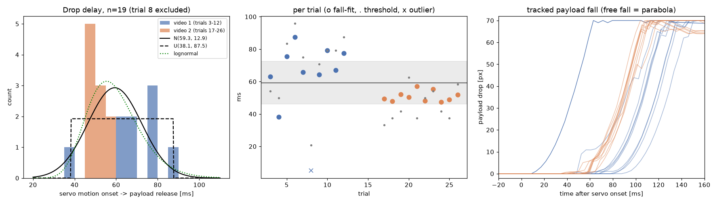

# Sim2Real 파라미터 모음 (지연 중심)

실기에서 잰 sim2real 관련 값을 한곳에 모았습니다. 표의 숫자는 모두 `data/`의 CSV에서 나왔고, CSV는 `measurements/`의 원자료에서
`scripts/build_sim2real_params.py`로 다시 만들 수 있습니다. 마지막 갱신: 2026-11-11.

기체 구성: Holybro Pixhawk 6C Mini (PX4 v1.16.2), Jetson Orin Nano Super (25 W), IMX219, ESC ×4 → I/O PWM 1–4 (PWM 400 Hz, DShot 미지원),
투하 서보 MG90S → FMU PWM 1 (50 Hz), 4S 배터리.

## 1. 지연 체인

```
[인식]  센서 SOF ─(카메라·ISP·전송·YOLO, ③)→ 검출 결과 ─(정책 10 Hz 샘플·홀드)→ 정책 입력
[제어]  정책 출력(10 Hz) → drone_controller(20 Hz, LPF α 0.4, τ≈75 ms) ─(USB uXRCE-DDS, ①)→ PX4 속도 루프
[투하]  정책 투하 결정 ─(USB uXRCE-DDS, ①)→ PX4 vehicle_command ─(④ 0–4 ms)→ FMU PWM 출력 변화
        ─(⑤ PWM 주기 대기 0–20 ms + 서보 내부 반응 δ)→ 서보 혼 움직임 시작 ─(⑥ 기계 해제 59 ± 13 ms)→ 페이로드 분리
```

## 2. 측정값과 시뮬 권장 분포

| # | 항목 | 실측 (요약) | 시뮬 권장 | 측정 방법 | 데이터 |
|---|---|---|---|---|---|
| ① | Jetson ↔ PX4 편도 (USB uXRCE-DDS, 보정 오프셋) | 평균 5.1 ± 2.7 ms, p50 5.2, p95 9.2, 최대 15–23 ms | 정책 10 Hz 기준 **0–1 step**, 또는 lognormal(중앙값 5.2 ms, σ 0.35) | `measure_link_latency.py`, 조건별 60 s, 약 6000 샘플 | `link_usb_xrce_20261028.csv` |
| ①′ | PX4 센서 샘플 → Jetson 수신 | p50 6.2, p95 10.0 ms | ①에 포함 | 같음 (`timestamp_sample`) | 같음 |
| ①″ | 명령 왕복 (Jetson → PX4 → ACK) | p50 10.5–11.1, p95 17.0–17.3, 최대 23 ms, 손실 0/1200 | (참고: commander 처리 주기 포함) | 같음 | 같음 |
| ② | PX4 오도메트리 주기 | 100.0 Hz, 간격 p99 12.3 ms | 100 Hz | 같음 | 같음 |
| ②′ | YOLO 부하가 링크에 주는 영향 | 없음 (A/B/C 조건 차이가 측정 오차 안) | — | YOLO 0/10/20 fps 동시 실행 | `link_usb_xrce_*`, `jetson_tegrastats_20261028.csv`, `yolo11n_trt_load_20261028.csv` |
| ③ | 카메라 SOF → 검출 결과 수신 (비행 설정 B) | **102.1 ± 9.8 ms**, p50 103, p95 113, 최대 141; 29.6 Hz, 1.4% 누락 | **N(102, 10²) ms, [90, 141]로 자름** + 노출 보정 `+exposure/2 − (y/H)·20.4 ms` | Argus 센서 SOF 타임스탬프 기준, 60 s | `camera_yolo_latency_20261105.csv` |
| ③′ | 정책이 보는 최신 검출의 나이 (무작위 시점) | p50 119.6, p95 138.9, 최대 173.3 ms | **10 Hz 정책 기준 1–2 step** 관측 지연 DR | 같음 (샘플·홀드 포함) | 같음 |
| ④ | PX4 명령 수신 → FMU PWM 출력 갱신 | 0–4 ms (`pwm_out` 4 ms 고정 주기, 실측 간격 평균 4.0 ms) | U(0, 4) ms | PX4 소스 + `pwm_out status` | — |
| ⑤ | PWM 주기 대기 (50 Hz) | 0–20 ms | U(0, 20) ms | 설정값 (`PWM_AUX_TIM0=50`) | `px4_output_config_20261108.csv` |
| ⑥ | **서보 움직임 시작 → 페이로드 분리** | **59.3 ± 13.3 ms** (n = 19), 중앙값 55.4, 범위 38–88 | **U(35, 90) ms** (보수적) 또는 N(59, 13) [35, 90] | 240 fps 영상, 낙하 포물선 역외삽 (아래 §3) | `drop_delay_*_20261108.csv` |
| ④–⑥ | **PX4 수신 → 분리** | 평균 71.3 ± 14.4 ms, p5 51, p95 98 | — | ⑥ + U(0,4) + U(0,20) 몬테카를로 | `drop_delay_summary_20261108.csv` |
| ①–⑥ | **Jetson 투하 명령 → 분리** | **평균 76.8 ± 14.5 ms**, p5 56, p50 75, p95 103 | `release_delay` 평균 **0.077 s**, 표준편차 **0.015 s** (또는 U(0.05, 0.105) s) | 위에 ①을 더함 | 같음 |
| — | 지상 PC → PX4 무선 MAVLink 명령 왕복 (57600 baud) | 60.3 ± 11.0 ms, p95 68.5, 최대 104 ms (n = 26) | 비행 경로 아님 (지상 시험용) | `DO_SET_ACTUATOR` ACK | `drop_radio_commands_20261108.csv` |
| — | I/O(ESC) 경로 제어 지연 | 평균 0.35 ms, 최대 1.14 ms | 무시 가능 | `px4io status` | — |
| — | 속도 명령 필터 | drone_controller 20 Hz, LPF α 0.4 (τ ≈ 75 ms) | Isaac과 같음 | 코드 | — |

## 3. 투하 지연 측정 상세 (2026-11-08, 벤치, 프롭 없음, 시동 꺼짐)

- 명령: 지상 PC → 무선(TELEM1) → `DO_SET_ACTUATOR`, 닫힘 1500 µs → 열림 1875 µs. 15초 간격으로 반복.
- 촬영: Samsung 슬로모션 240 fps (`com.android.capture.fps: 240`, 파일은 30 fps로 저장되어 8배 느리게 재생). 1프레임 = 4.17 ms.
- 서보 시작: 서보 혼 영역이 정지 상태 평균 영상에서 벗어나기 시작한 프레임(선형 역외삽, 프레임 미만 정밀도).
- 분리: 페이로드 세로 위치를 프레임마다 추적해 자유낙하 `s = ½ a (t − t_r)²`로 역외삽. 영상 1의 깨끗한 회차는 a = 0.72–0.80 px/frame²로 일정, 잔차 0.03–0.3 px. 단순 임계값 방식과 r = 0.87. 20회 모두 프레임을 눈으로 확인.
- 8회차(5 ms)는 서보가 움직이자마자 분리된 경우로, **래치가 거의 걸리지 않은 장착**으로 판단해 통계에서 뺐습니다. 실제 장착 불량 시 이런 조기 분리가 생길 수 있습니다.

| 부분집합 | n | 평균 | 표준편차 | 중앙값 | 범위 | p5–p95 |
|---|---|---|---|---|---|---|
| 전체 (8회차 제외) | 19 | 59.3 | 13.3 | 55.4 | 38.1–87.5 | 46.6–80.1 |
| 영상 1 (3–12회차) | 9 | 68.7 | 14.1 | 67.0 | 38.1–87.5 | |
| 영상 2 (17–26회차) | 10 | 50.9 | 3.2 | 50.0 | 47.5–57.1 | |

분포 적합 (n = 19): 균등 AIC 152.2, 로그정규 153.5 (KS p 0.63), 감마 153.8, 정규 155.2, Shapiro p = 0.18. **AIC 차이가 3 이하라서 분포 모양은 아직 가를 수 없습니다.**

상관 (n = 19):

| 쌍 | r | p | 해석 |
|---|---|---|---|
| 지연 vs 회차 순서 | −0.49 | 0.03 | 영상 1·2 평균 차이 때문. 영상 안에서는 0.42 (p 0.26), 0.07 (p 0.85)로 추세 없음 |
| 직전 회차와 (lag-1) | 0.34 | 0.17 | 유의하지 않음 → 회차별 독립 샘플링 가능 |
| 지연 vs 무선 명령 왕복 | 0.16 | 0.51 | 무관 → 링크 지연과 기계 지연은 따로 랜덤화 |
| 서보→슬라이더 vs 슬라이더→분리 | −0.79 | 6e-5 | 분리가 서보 각도에 묶여 있음 (슬라이더 시점 오차가 반대 부호로 들어가 과장됐을 수 있음) |
| 영상 1 vs 2 평균 / 분산 | Welch p 0.005 / Levene p 0.03 | | 장착 방식 차이 또는 영상 2 초점 흐림(±1–2 프레임). 원인 미확정 |



## 4. 현재 시뮬·코드 가정과 다른 점 (조치 필요)

| 항목 | 지금 코드/문서 | 실측 | 비고 |
|---|---|---|---|
| 투하 지연 | `policy_core.RELEASE_DELAY_MEAN = 0.22` s, 문서 0.22 ± 0.05 s | **0.077 ± 0.015 s** (Jetson 명령 → 분리) | 약 3배 짧음. 벤치 값이므로 비행 진동 영향은 미확인 |
| 정책 주기 | 저장소 README의 링크·인식 절은 "정책 20 Hz, 50 ms"로 step 수를 계산 | `drop_policy`는 **10 Hz** (`EPISODE_STEPS = 300` = 30 s) | 10 Hz 기준이면 링크 0–1 step, 인식 1–2 step |
| 투하 경로 | 시뮬은 투하 결정 즉시(지연 큐) 분리 | 50 Hz PWM 대기(0–20 ms)는 실제로 무작위 | 균등 성분으로 그대로 넣는 것이 맞음 |

## 5. 아직 재지 않은 것

- 서보 내부 반응 δ (PWM 변화 → 혼이 보이게 움직이기 시작): 이번 방법으로 분리 불가. LED 마커(FMU AUX5/6, 400 Hz) 또는 분리 센서(Camera Capture)로 측정 예정. 그래서 ④–⑥ 합계가 δ만큼 짧게 나왔을 수 있습니다.
- 비행 중(프롭 진동) 투하 지연, 실외 노출 시간(③ 보정항).
- Jetson uXRCE-DDS `VehicleCommand` 경로로 보낸 투하 명령의 실측 (현재 ①은 오도메트리·설정점 기준).
- 시스템 식별 값(추력 곡선, 모터 시정수, 관성, 속도 계단응답): `system_identification` 패키지로 측정 예정.

## 6. 데이터 파일

| 파일 | 내용 | 단위 |
|---|---|---|
| `data/link_usb_xrce_20261028.csv` | 링크 지연 요약 (조건 A 무부하 / B YOLO 10 fps / C YOLO 최대, 첫 측정은 무효 표시) | ms, Hz |
| `data/jetson_tegrastats_20261028.csv` | 링크 측정 중 1초 간격 CPU 코어별·GPU 사용률, 온도, RAM | %, °C, MB |
| `data/yolo11n_trt_load_20261028.csv` | 부하용 YOLO 단계별 시간 | ms |
| `data/camera_yolo_latency_20261105.csv` | 카메라 SOF → 검출 단계별 지연, 결과 주기, 누락률, 무작위 시점 나이 | ms, Hz |
| `data/drop_radio_commands_20261108.csv` | 투하 명령 26회: 송신 시각, ACK 왕복, 재전송, TIMESYNC 불확실성 | ms |
| `data/drop_delay_video_20261108.csv` | 영상 20회: 서보 시작·슬라이더·분리 프레임, 구간별 지연, 이상값 표시 | frame (1/240 s), ms |
| `data/drop_video_payload_tracks_20261108.csv` | 회차별 페이로드 낙하 추적 (서보 시작 기준 −40~+250 ms) | ms, px |
| `data/drop_delay_summary_20261108.csv` | 부분집합별 요약 통계 | ms |
| `data/drop_delay_fits_20261108.csv` | 정규·균등·로그정규·감마 적합, AIC, KS | — |
| `data/drop_delay_correlations_20261108.csv` | 상관 (Pearson, Spearman), 영상 간 검정 | — |
| `data/px4_output_config_20261108.csv` | 서보·ESC 출력 파라미터 (변경 전/후) | µs, Hz |

원자료(JSON, 로그)는 `measurements/`, 영상 분석 스크립트는 `scripts/drop_video/`에 있습니다. 원본 영상(각 1.8 GB)은 저장소에 넣지 않았습니다.

다시 만들기:

```bash
python3 scripts/build_sim2real_params.py --drop-results <analyze_drop.py가 만든 drop_delay_results.json>
```
